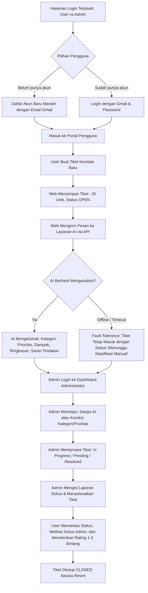

# Ticketing Trans Hamana - Sistem Manajemen Tiket Helpdesk Berbasis AI (User & Admin)

Aplikasi web manajemen tiket helpdesk modern dengan alur kerja langsung antara **User (Pengguna/Karyawan)** dan **Admin (Administrator IT)**, terintegrasi dengan kecerdasan buatan (AI) untuk diagnosis otomatis, penanganan langsung oleh Admin, serta evaluasi kepuasan pengguna.

---

## 🚀 Alur Kerja Sistem (Workflow)



---

## 👤 Dua Cara Menambahkan User Baru (Gmail)

1. **Pendaftaran Mandiri oleh Pengguna (Self Registration)**:
   - Pada halaman awal, pilih tab **Portal Pengguna**.
   - Klik tombol **`+ Daftar Gmail`** di pojok kanan atas formulir.
   - Masukkan **Nama Lengkap**, **Alamat Gmail** (misal: `nama.anda@gmail.com`), **Divisi**, dan **Password**.
   - Klik **"Daftarkan Akun & Langsung Masuk"**. Akun akan otomatis tersimpan dan Anda langsung diarahkan ke portal pengguna.

2. **Ditambahkan oleh Administrator (Admin Management)**:
   - Login ke **Portal Administrator** (`admin@perusahaan.co.id` / `admin123`).
   - Pada header dashboard, klik tombol **`+ Tambah User (Gmail)`**.
   - Masukkan nama user, alamat Gmail, divisi, dan password sementara.
   - User tersebut dapat langsung login menggunakan kredensial yang dibuat oleh Admin.

---

## 🔑 Kredensial Akun Bawaan (Demo)

| Peran (Role) | Alamat Email | Password | Keterangan Akses |
|---|---|---|---|
| **User Demo 1** | `user@perusahaan.co.id` | `user123` | Akun demo karyawan divisi akuntansi |
| **User Demo 2** | `siti@perusahaan.co.id` | `user123` | Akun demo karyawan divisi marketing |
| **User Gmail Baru** | *(Email Gmail Anda)* | *(Password Anda)* | Hasil pendaftaran mandiri atau input Admin |
| **Administrator IT** | `admin@perusahaan.co.id` | `admin123` | Dashboard verifikasi AI, proses tiket, & tambah user |

---

## 💻 Cara Menjalankan Aplikasi

Aplikasi saat ini aktif di:
👉 **[http://localhost:3000](http://localhost:3000)**

Untuk menjalankan ulang sewaktu-waktu:
- **Cara Praktis**: Cukup klik ganda file **`jalankan-aplikasi.bat`** di folder proyek.
- **Lewat Terminal PowerShell**:
  ```powershell
  npm.cmd start
  ```
